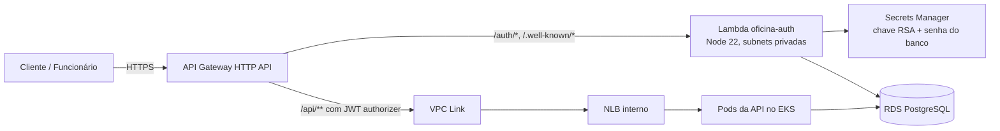

# fiap-15soat-oficina-lambda-auth

Autenticação da Oficina Mecânica (Tech Challenge Fase 3): uma Function Serverless que emite os
tokens de sessão e o API Gateway que é a porta de entrada única do sistema.

Um de quatro repositórios:
[`api`](https://github.com/KauaAlmeidaSilveira/fiap-15soat-oficina-api) ·
[`infra-k8s`](https://github.com/JulioNCavalcanti/fiap-15soat-oficina-infra-k8s) ·
[`infra-db`](https://github.com/JulioNCavalcanti/fiap-15soat-oficina-infra-db) ·
**`lambda-auth`**

## Arquitetura



## Autenticação

CPF é praticamente um dado público: identifica, mas não autentica. Por isso o cliente entra com
**CPF + senha**, e a senha é criada no primeiro acesso, conferindo o e-mail do cadastro.

| Rota | Corpo | Resposta |
|---|---|---|
| `POST /auth/funcionario` | `{"username", "senha"}` | `200 {token, expiresIn: 28800}` · 401 |
| `POST /auth/cliente` | `{"cpf", "senha"}` | `200 {token, expiresIn: 3600}` · 400 CPF inválido/CNPJ · 401 · 403 inativo |
| `POST /auth/cliente/primeiro-acesso` | `{"cpf", "email", "senha"}` | `201 {token, expiresIn: 3600}` · 400 · 422 |
| `GET /.well-known/openid-configuration` | — | discovery usado pelo JWT authorizer |
| `GET /.well-known/jwks.json` | — | chave pública |

Tokens: RS256, `aud = oficina-api`, `iss` = URL do Gateway. Funcionário recebe as roles do banco;
cliente recebe `roles = ["CLIENTE"]` e `sub` = id do cliente. As rotas `/auth/*` têm throttling de
5 req/s (burst 10).

Erros seguem RFC 7807 (`application/problem+json`). Cliente inexistente, sem senha ou com senha
errada recebem a mesma resposta 401; o status `INATIVO` só é revelado depois que a senha confere.

## Tecnologias

Node.js 22 · `pg` · `bcryptjs` · `jose` · AWS Lambda · API Gateway HTTP API · Secrets Manager ·
Terraform · GitHub Actions

## Desenvolvimento

```bash
nvm use                      # Node 22
npm ci
npm test                     # unitários

docker run -d --name oficina-auth-pg -e POSTGRES_PASSWORD=postgres -p 5433:5432 postgres:16
npm run test:integracao      # repositório contra Postgres real

# Token para chamar a API rodando em localhost:8080, sem Gateway
npm run token:local -- --sub kaua@gmail.com --roles ADMIN
```

Os testes de integração apagam e recriam as tabelas `users`, `roles`, `users_roles` e `cliente`.
Para usar outro Postgres, aponte `DATABASE_URL_TESTE` para um banco **dedicado** a esses testes.

## Deploy

Pipeline em `.github/workflows/ci-cd.yml`:

| Evento | O que roda |
|---|---|
| Pull request | testes unitários e de integração, `terraform fmt`/`validate`/`plan` com o plano comentado no PR |
| Push em `main` | testes, empacotamento, `terraform apply` no Environment `producao` e smoke test |

Secrets: `AWS_ACCESS_KEY_ID`, `AWS_SECRET_ACCESS_KEY`, `AWS_SESSION_TOKEN` (painel do Academy),
`DB_PASSWORD` (a mesma do `infra-db`) e `JWT_PRIVATE_KEY` (a mesma da API).

### Ordem de subida (primeira vez)

1. `infra-k8s` → `infra-db`
2. Deploy da API: cria o NLB interno e a coluna `cliente.senha_hash`
3. Este repositório: encontra o NLB por tag e publica o Gateway
4. Copiar o output `api_gateway_url` para o secret `APP_PUBLIC_BASE_URL` da API
5. Novo deploy da API (passa a aceitar tokens com esse emissor)

### Ordem de destruição

Este repositório **antes** de remover o `Service` da API (o VPC Link aponta para o listener do NLB),
e antes de `infra-db` e `infra-k8s`.

## Observações sobre o AWS Academy

A Lambda usa a `LabRole` pré-existente (`iam:CreateRole` é bloqueado). O segredo é criado sem
janela de recuperação para permitir destruir e recriar o ambiente com o mesmo nome. A Lambda alcança
o Secrets Manager pelo NAT gateway da VPC, sem VPC endpoint.
