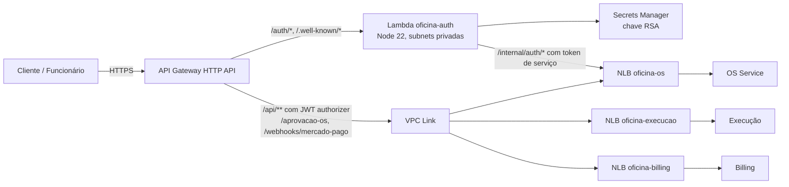

# fiap-15soat-oficina-lambda-auth

Autenticação da Oficina Mecânica (Tech Challenge Fase 4): uma Function Serverless que emite os
tokens de sessão e o API Gateway que é a porta de entrada única dos 3 microsserviços.

Repositórios da Fase 4:
[`os`](https://github.com/KauaAlmeidaSilveira/fiap-15soat-oficina-os) ·
[`execucao`](https://github.com/KauaAlmeidaSilveira/fiap-15soat-oficina-execucao) ·
[`billing`](https://github.com/KauaAlmeidaSilveira/fiap-15soat-oficina-billing) ·
[`infra-k8s`](https://github.com/JulioNCavalcanti/fiap-15soat-oficina-infra-k8s) ·
[`infra-db`](https://github.com/JulioNCavalcanti/fiap-15soat-oficina-infra-db) ·
**`lambda-auth`**

## Arquitetura



## Rotas por serviço

Cada prefixo vai para o NLB interno do seu serviço (`terraform/api_gateway.tf`). O API Gateway HTTP
API não aceita `{proxy+}` vazio, então cada prefixo tem duas rotas: o prefixo e `prefixo/{proxy+}`.

| Serviço | Com JWT | Sem JWT |
|---|---|---|
| OS | `/api/auth`, `/api/clientes`, `/api/veiculos`, `/api/ordens-servico`, `/api/minhas-ordens-servico` | `/actuator/health`, Swagger |
| Execução | `/api/execucoes`, `/api/produtos` | — |
| Billing | `/api/orcamentos`, `/api/pagamentos` | `GET /aprovacao-os` (token próprio no link), `POST /webhooks/mercado-pago` |

`/internal/*` e `/api/simulacao/*` não passam pelo Gateway.

## Autenticação

CPF é praticamente um dado público: identifica, mas não autentica. Por isso o cliente entra com
**CPF + senha**, e a senha é criada no primeiro acesso, conferindo o e-mail do cadastro.

| Rota | Corpo | Resposta |
|---|---|---|
| `POST /auth/funcionario` | `{"username", "senha"}` | `200 {token, expiresIn: 28800}` · 401 |
| `POST /auth/cliente` | `{"cpf", "senha"}` | `200 {token, expiresIn: 3600}` · 400 CPF inválido/CNPJ · 401 · 403 inativo |
| `POST /auth/cliente/primeiro-acesso` | `{"cpf", "email", "senha"}` | `201 {token, expiresIn: 3600}` · 400 · 422 |
| `GET /.well-known/openid-configuration` | — | discovery usado pelo JWT authorizer |
| `GET /.well-known/jwks.json` | — | chave pública |

A Lambda não acessa banco: lê usuários e clientes pelas rotas `/internal/auth/*` do OS Service, com
um token próprio de 60 segundos (`iss = oficina-lambda-auth`, `aud = oficina-os`).

Tokens: RS256, `aud = oficina-api`, `iss` = URL do Gateway. Funcionário recebe as roles do cadastro no OS Service;
cliente recebe `roles = ["CLIENTE"]` e `sub` = id do cliente. As rotas `/auth/*` têm throttling de
5 req/s (burst 10).

Erros seguem RFC 7807 (`application/problem+json`). Cliente inexistente, sem senha ou com senha
errada recebem a mesma resposta 401; o status `INATIVO` só é revelado depois que a senha confere.

## Tecnologias

Node.js 22 · `bcryptjs` · `jose` · AWS Lambda · API Gateway HTTP API · Secrets Manager ·
Terraform · GitHub Actions

## Desenvolvimento

```bash
nvm use                      # Node 22
npm ci
npm test                     # unitários
npm run test:integracao      # repositório contra servidor HTTP com o contrato interno

# Token para chamar a API rodando em localhost:8080, sem Gateway
npm run token:local -- --sub kaua@gmail.com --roles ADMIN
```

## Deploy

O workflow `.github/workflows/ci-cd.yml` (testes, `plan` em PR, `apply` e smoke test em `main`)
continua no repositório, mas o GitHub Actions da conta está bloqueado por billing. Na Fase 4 o `apply`
é manual, pela conta AWS pessoal do Júlio, como parte do `scripts/subir-aws.sh` do repositório do OS:

```bash
npm ci && npm run empacotar
cd terraform
TF_VAR_jwt_private_key="$(cat ../../fiap-15soat-oficina-os/.local/chaves/sessao.private.key)" terraform apply
```

`os_internal_url` é opcional: sem ele, a Lambda chama o NLB interno do OS.

### Ordem de subida

1. `infra-k8s` → `infra-db`
2. Deploy dos 3 serviços: cada `Service` LoadBalancer cria o NLB interno do serviço
3. Este repositório: encontra os NLBs pela tag `kubernetes.io/service-name` e publica o Gateway
4. Novo deploy dos serviços, com `api_gateway_url` como emissor dos tokens e base do link de aprovação

### Ordem de destruição

Este repositório **antes** de remover os `Service`s (o VPC Link aponta para os listeners dos NLBs),
e antes de `infra-db` e `infra-k8s`.

## IAM e segredo

A Lambda tem role própria (`oficina-auth-lambda`): logs, ENIs na VPC e leitura só do segredo
`oficina/auth`. O segredo é criado sem janela de recuperação para permitir destruir e recriar o
ambiente com o mesmo nome. A Lambda alcança o Secrets Manager pelo NAT gateway da VPC, sem VPC endpoint.
